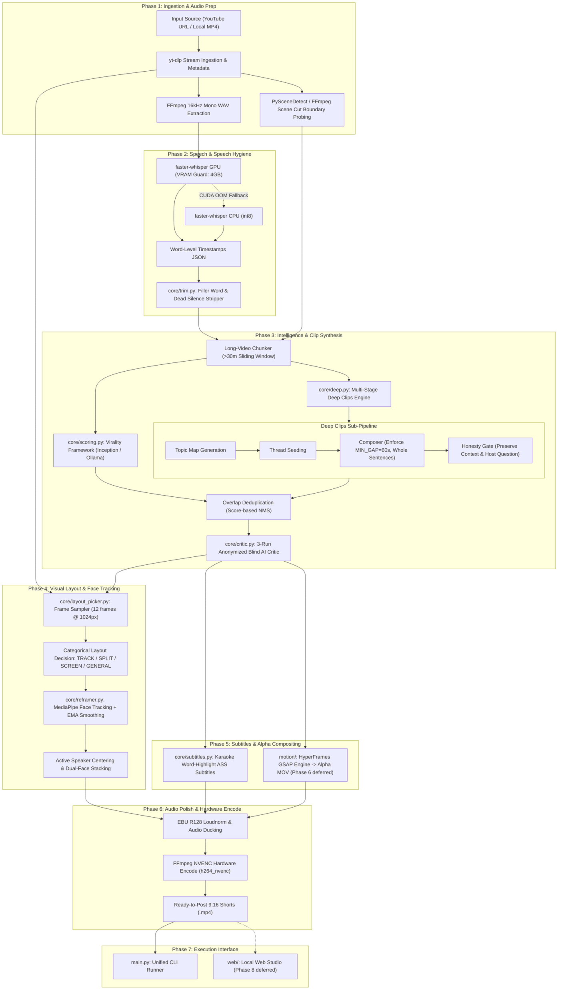

# VideoShorts: Production Engineering Blueprint

## 1. Architectural Foundation & Ground Truth
This blueprint fuses the verified, production-grade mechanics of **ClipKaro** and **OpenShorts**, stripping out external third-party cloud lock-in (MuAPI) and establishing a resilient, 100% self-hosted or API-flexible engine optimized for consumer hardware (NVIDIA RTX 3050 4GB VRAM + CPU fallback).

**Default LLM Provider**: **Inception Labs (`mercury-3`)** via `/v1/chat/completions` (with local Ollama `llama3.2`, Google Gemini, and OpenAI as interchangeable backends).

---

## 2. End-to-End Execution Pipeline

---

## 3. Detailed Component Specifications

### Module 1: `core/ingest.py` & Scene Probing
- Ingestion via `yt-dlp` targeting best video/audio streams up to 1080p.
- `ffmpeg -vn -acodec pcm_s16le -ar 16000 -ac 1` for Whisper-optimal audio extraction.
- Scene change detection via `scenedetect` or `ffmpeg -vf select='gt(scene,0.3)'` outputting timestamped cut points.

### Module 2: `core/transcribe.py` & `core/trim.py`
- **VRAM Budgeting**: RTX 3050 has 4GB VRAM.
  - Primary: `faster-whisper` with `device="cuda"`, `compute_type="float16"`.
  - Fallback: Automatic catch on CUDA OOM falling back to `device="cpu"`, `compute_type="int8"`.
- Precise word timestamp alignment (`words=[{word, start, end, probability}]`).
- **Trimming (`core/trim.py`)**:
  - Drops long conversational silence gaps (`>1.2s`) to keep short-form pacing tight.
  - Cleans identified verbal tics (`um`, `uh`, `ah`) while respecting word boundary timestamps.

### Module 3: Intelligence Suite (`scoring.py`, `deep.py`, `critic.py`)
1. **Virality Framework (`scoring.py`)**:
   - Scores candidates across 4 core dimensions: Hook (weight 3x), Narrative Payoff (weight 3x), Emotion & Intensity (weight 2x), Quotability (weight 1x).
   - Chunks videos >30 min with sliding overlap windows.
2. **Deep Clips Engine (`deep.py`)**:
   - Implements the multi-stage machine:
     - `Topic Map`: Outlines macro narrative points across the full recording.
     - `Thread Seeding`: Identifies setups that have payoffs later in the video.
     - `Composer`: Stitches segments with hard rules: `MIN_GAP >= 60s`, strictly complete sentences, question-and-answer integrity.
     - `Honesty Gate`: Semantic check preventing decontextualized or misleading Frankenstein edits.
3. **Overlap Deduplication**:
   - Non-Maximum Suppression (NMS) on time spans: if Clip A and Clip B overlap by >30% temporal duration, the lower-scoring candidate is pruned.
4. **Statistical AI Critic (`critic.py`)**:
   - Evaluates each surviving candidate through 3 randomized, independent passes with neutral tokens (`K7`, `B2`, `M9`) to prevent position or naming bias.
   - Gate requirement: Must pass at least 2 of 3 runs; failures auto-trigger trim repairs or rejection.

### Module 4: Layout & Visual Reframing (`core/layout_picker.py` & `core/reframer.py`)
- **Layout Picker (`layout_picker.py`)**: Samples 12 keyframes from the clip duration, resizing to 1024px. Classifies layout into `TRACK`, `SPLIT`, `SCREENCAST`, or `GENERAL`.
- **Smart Reframer (`reframer.py`)**:
  - Detects speaker faces using MediaPipe Face Detection (with OpenCV fallback).
  - Applies **Exponential Moving Average (EMA)** smoothing (`alpha=0.15`) across frame coordinates to completely eliminate camera micro-jitter.
  - Computes clamped 9:16 bounding box `(x, y, w, h)`.

### Module 5: Subtitles & HyperFrames Motion (`core/subtitles.py` & `motion/`)
- Dynamic ASS subtitle generator rendering word-level karaoke glow/highlighting (active word in gold/yellow, inactive in white).
- Optional top hook banner overlay.

### Module 6: Audio Polish & Hardware Encode (`core/renderer.py`)
- Audio processing with two-pass EBU R128 `loudnorm` filter (`-af loudnorm=I=-16:TP=-1.5:LRA=11`).
- Hardware accelerated rendering via `ffmpeg` using `h264_nvenc` with preset `p4` (or CPU `libx264` fallback).

### Module 7: Unified Execution Interface (`main.py`)
- Full CLI coordinator supporting clip count, layout overrides, and deep clip/critic toggles.

---

## 4. Phase-by-Phase Implementation Roadmap

| Phase | Deliverable | Status | Key Files |
| :--- | :--- | :--- | :--- |
| **Phase 1** | Ingestion & LLM Provider (Inception / Ollama) | **Done** | `config.py`, `core/llm.py`, `core/ingest.py` |
| **Phase 2** | GPU Whisper ASR + Memory Guard + Silence/Filler Trimming | **Done** | `core/transcribe.py`, `core/trim.py` |
| **Phase 3** | Virality Scorer, Deep Clips Sub-Pipeline, Dedup, & 3-Pass Critic | **Done** | `core/scoring.py`, `core/deep.py`, `core/critic.py` |
| **Phase 4** | Keyframe Layout Picker, MediaPipe Face Tracking, & EMA Smoothing | **Done** | `core/layout_picker.py`, `core/reframer.py` |
| **Phase 5** | Word-Level Animated Subtitles | **Done** | `core/subtitles.py` |
| **Phase 6** | Audio Normalization & Hardware NVENC Render Pipeline | **Done** | `core/renderer.py` |
| **Phase 7** | Unified CLI Execution Engine | **Done** | `main.py` |
| **Phase 8** | HyperFrames Motion & Local Web Reviewer | Later Phase | `motion/`, `web/` |
